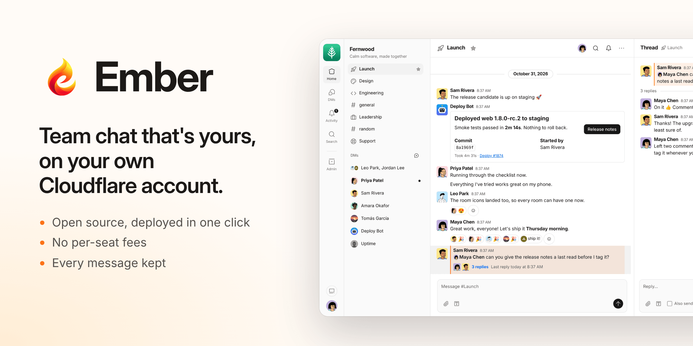
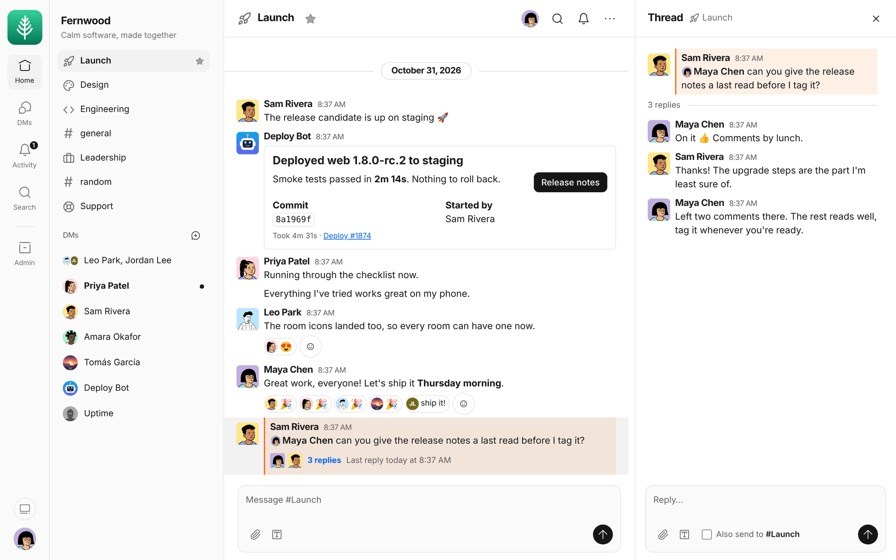
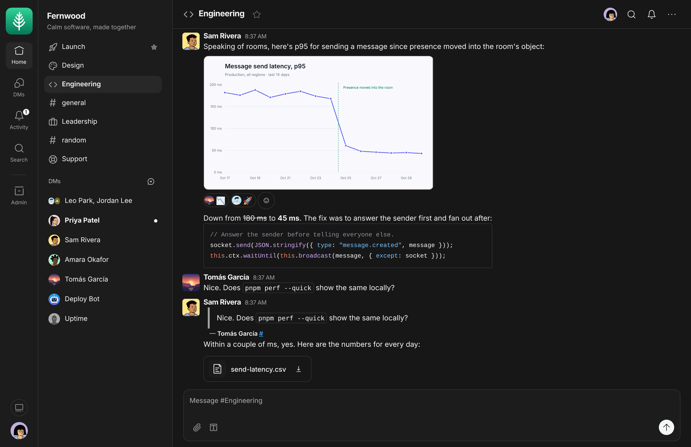
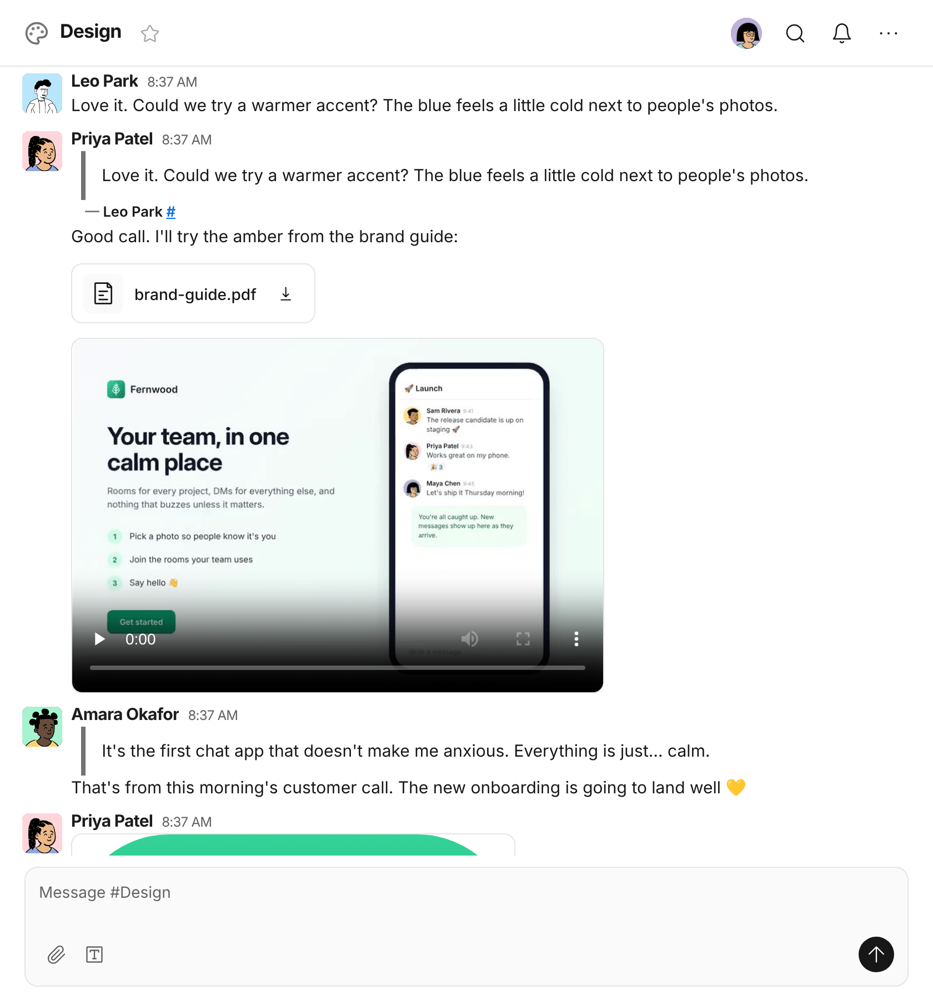
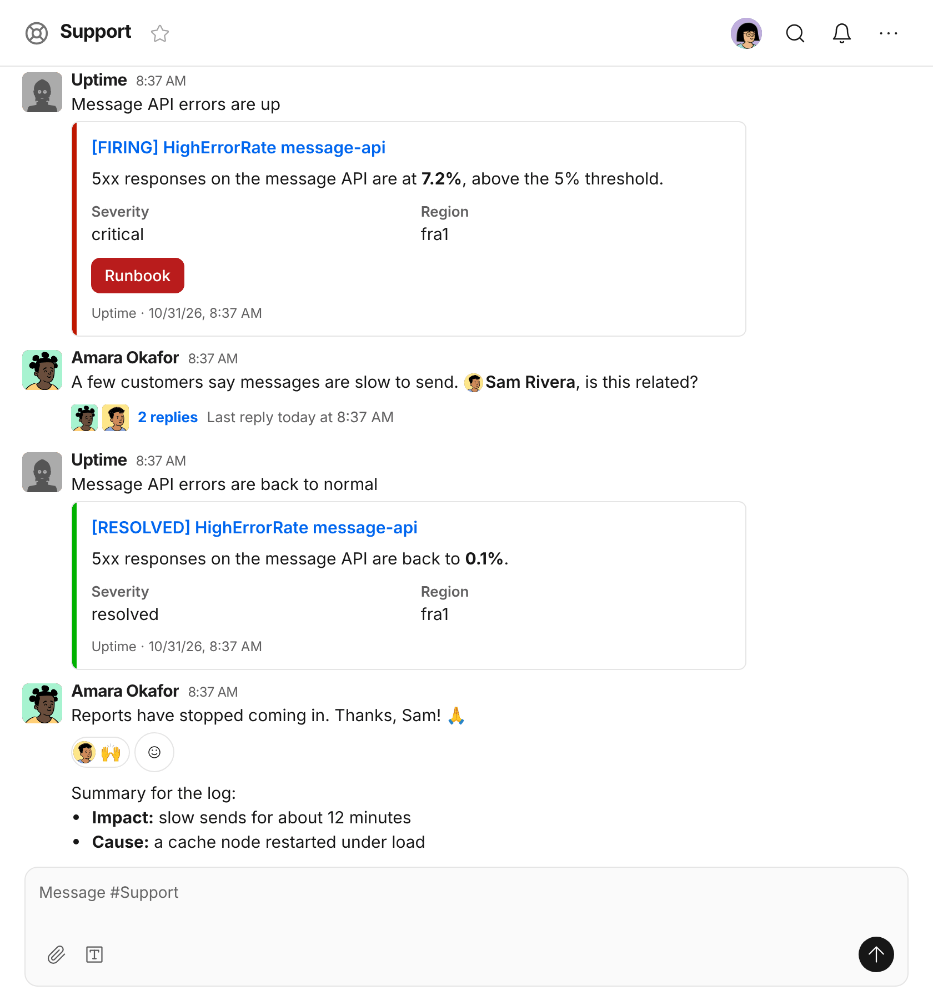
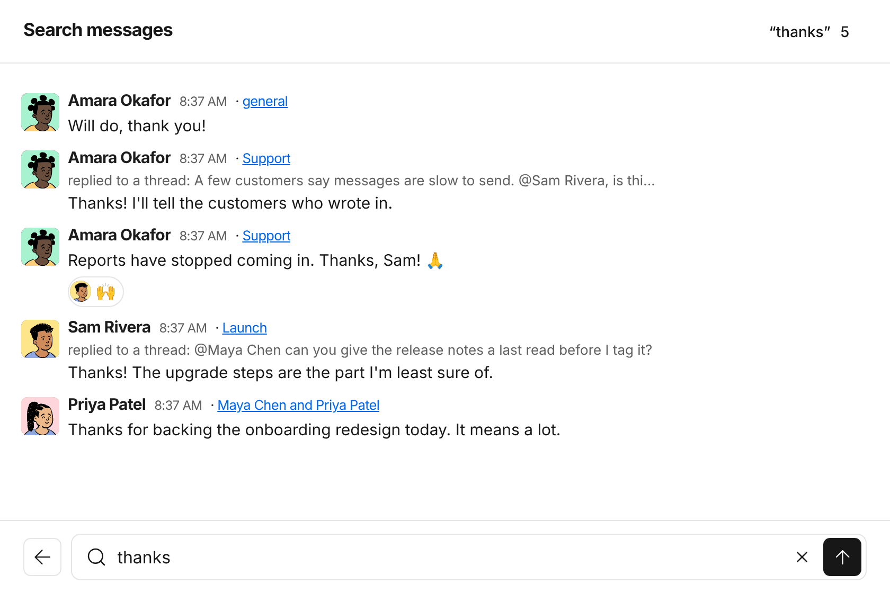
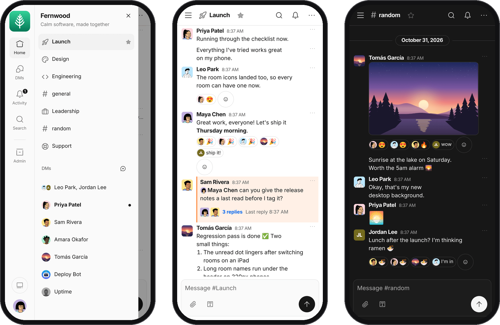
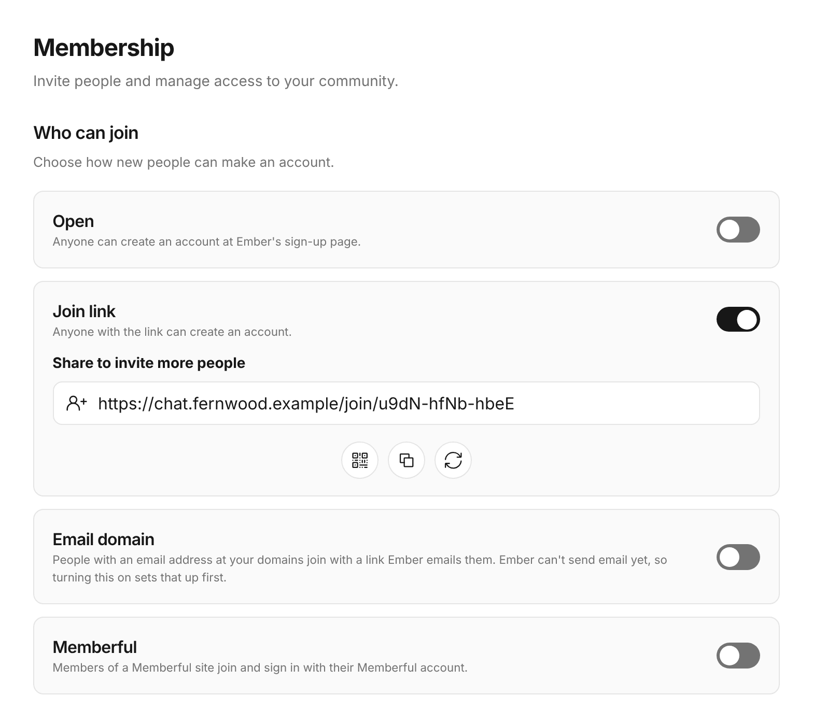

<p align="center">
  
</p>

<p align="center">
  A real-time chat app that runs entirely on Cloudflare.<br>
  Rooms, threads, DMs, files, search, bots and push notifications, deployed in one click.
</p>

<p align="center">
  <a href="https://deploy.workers.cloudflare.com/?url=https://github.com/NYLLON-SOFTWARE/ember-cloudflare"></a>
</p>

<p align="center">
  <a href="#everything-your-team-needs">Features</a> ·
  <a href="#ember-and-slack-side-by-side">Ember vs Slack</a> ·
  <a href="#what-it-costs">What it costs</a> ·
  <a href="#get-started">Get started</a> ·
  <a href="docs/self-hosting.md">Self-hosting guide</a>
</p>

## Why Ember

**Pay for the chat, not for every person in it.** Ember is free and open source, and runs on your own
Cloudflare account: free for a small team, and $5 a month for the whole account as you grow. Slack Pro
charges $7.25 for every person, every month, billed annually.

**Keep every message.** Nothing ages out. Slack's free plan shows only the last 90 days and deletes
messages once they're a year old; Ember keeps every message and file for as long as you do.

**Own your conversations.** Messages live in Durable Objects, and files in an R2 bucket, in your
Cloudflare account. Nobody else hosts your team's chat, and the code is yours to read, change and run.

**Nothing to look after.** No servers, containers or databases to patch. One click puts Ember on
Cloudflare's network, quiet rooms hibernate, and every push to your copy deploys again.

## Everything your team needs

### Conversations that stay on topic

Rooms for every project, private rooms for the few who need them, and DMs with one person or a few.
Reply in a thread to keep a room on topic, and tick **Also send to the room** when everyone should see
the answer. Mention people, quote a message, react with any emoji or a few words of your own, and edit
or delete what you wrote.

Unread rooms stand out, **Activity** narrows the list to what you haven't read, and each room's bell
says whether you hear about every message, only mentions, or nothing. You see who's here and who's
typing, as it happens.



<p align="center">
  <sub>The people and conversations in these screenshots are made up: they're the Fernwood team that <code>pnpm seed</code> creates.</sub>
</p>

### Say it clearly

Bold, lists, quotes, and code blocks with syntax highlighting. Paste a link and Ember shows a preview,
and share a chart, a spreadsheet or anything else right in the conversation. Light, dark, or whatever
your system says.



### Files, pictures and video

Share files of up to 250 MB. Pictures show in the conversation, videos play where they're posted, and
everything else is a click away. Files go to an R2 bucket in your Cloudflare account, which charges
nothing for downloads.



### Bots that already speak Slack

Point Alertmanager, Grafana, your CI pipeline, or anything else that posts to a Slack incoming webhook
at Ember instead. Every bot gets a Slack-compatible webhook URL for each of its rooms, which takes the
same payloads, with Slack's formatting, attachments and Block Kit cards. Bots can answer too: mention
one, or DM it, and Ember sends the message to the bot's own webhook and posts its reply.



### Ask @ember

Turn on Ember AI and choose a model, from Workers AI's free ones to Claude, GPT or Gemini, through
[Cloudflare AI Gateway](https://developers.cloudflare.com/ai-gateway/). Then mention @ember in a room
or a thread, or DM it, and it reads the conversation and answers right there, with links, lists, code
and pictures, as a teammate would. Administrators set how long it may think and write, and each person
picks their own levels on their profile.

### Find anything

Search every message in the rooms and DMs you're in, thread replies included.



### On your phone

Add Ember to your home screen on an iPhone or Android phone, or install it on your computer, and turn
on push notifications for the messages you want to hear about. It's made for phones: a drawer for your
rooms, tap targets sized for thumbs, nothing hiding under the notch, and messages written without
signal send once you're back online. To sign in on your phone, scan the QR code on your profile.



### Make it yours

Give Ember your community's name, logo and tagline, pick icons for rooms and the navigation, restyle it
with custom CSS, and serve it at your own domain, which Ember walks you through setting up. Then choose
who gets in: anyone with the join link or its QR code, the people you invite by email, anyone with an
address at your company's domain, the members of your [Memberful](https://memberful.com) site, or
everyone, with [Cloudflare Turnstile](https://www.cloudflare.com/application-services/products/turnstile/)
keeping bots out.

<p align="center">
  
</p>

## Ember and Slack, side by side

Slack does more, and charges for it per person. Ember does the everyday core of team chat well, and
it's yours. Slack's plans are as [slack.com/pricing](https://slack.com/pricing) listed them in October
2026.

### Price and ownership

| | Ember | Slack |
|---|---|---|
| **Price** | Free and open source. You pay Cloudflare $0, or $5 a month for the whole account | Free plan, or $7.25 (Pro) or $15 (Business+) per person a month, billed annually |
| **Message history** | Everything, for as long as you keep it | Free: the last 90 days, and messages are deleted after a year. Paid plans: everything |
| **Where it runs** | Your Cloudflare account | Slack's cloud |
| **Source code** | MIT license, on GitHub | Closed |
| **Your own domain** | ✅ such as chat.example.com | — only yourteam.slack.com |
| **Branding** | Name, logo, tagline, room and navigation icons, and custom CSS | Workspace name and icon |

### Everyday chat

| | Ember | Slack |
|---|---|---|
| **Rooms, private rooms and DMs** | ✅ | ✅ |
| **Threads** | ✅ with Also send to the room | ✅ with Also send to the channel |
| **Mentions, quotes, reactions and edits** | ✅ react with any emoji or a few words | ✅ plus custom emoji |
| **Rich text, code blocks and link previews** | ✅ | ✅ |
| **Files** | ✅ up to 250 MB each | ✅ up to 1 GB each |
| **Search** | ✅ every message in your rooms and DMs | ✅ (Free: the last 90 days) |
| **Unread, Activity, starred rooms, per-room notifications** | ✅ | ✅ |
| **Phones** | ✅ installable web app with push notifications | ✅ native iPhone and Android apps |
| **Computers** | ✅ any modern browser, or installed as an app | ✅ native Mac, Windows and Linux apps, or the browser |
| **Light and dark** | ✅ | ✅ |
| **Incoming webhooks** | ✅ Slack-compatible, with attachments and Block Kit | ✅ |
| **Bots that answer** | ✅ through a webhook per bot | ✅ through Slack apps |
| **Ways to join** | Join link and QR code, email invitations, email domains, open sign-up with Turnstile, Memberful | Invitations, invite links and approved email domains |
| **Single sign-on** | Memberful, for membership communities | Google on every plan, and SAML SSO with SCIM on Business+ |

### Where Slack does more

| | Ember | Slack |
|---|---|---|
| **Apps and workflows** | — | ✅ a directory of 2,600+ apps (Free: 10 of them) and Workflow Builder |
| **Voice and video calls** | — | ✅ huddles (Free: one-on-one only) |
| **AI** | @ember answers when you mention or DM it, on the model you choose | ✅ summaries, recaps and AI search on every plan, more on Business+ |
| **Canvases, lists and clips** | — | ✅ |
| **Channels shared with other companies** | — | ✅ Slack Connect |
| **Scheduled messages and reminders** | — | ✅ |
| **Guest accounts** | — | ✅ on paid plans |
| **Exports of every message, DMs included** | — not yet | ✅ on Business+ and up |
| **Support** | GitHub issues | ✅ 24/7 on Business+ |

If your team lives in huddles, workflows and a hundred integrations, Slack earns its price. If you
want fast, calm, searchable chat that you own outright, Ember is built for you.

## What it costs

Ember is free. Cloudflare runs it, at its own prices:

| | What you pay Cloudflare |
|---|---|
| **A small team** | $0 on the [Workers Free](https://developers.cloudflare.com/workers/platform/pricing/) plan. From what we measured each message writes, it carries about 100 people a day sending 30 messages each. |
| **A growing team** | $5 a month on Workers Paid, for the whole account. It includes 50 million database rows written a month, where Free allows 100,000 a day, and bills any use past its allowances. |
| **Files** | 10 GB in [R2](https://developers.cloudflare.com/r2/pricing/) free, then $0.015 per GB a month, with nothing to pay for downloads. |
| **Email, if you want it** | Free with [Resend](https://resend.com), up to 3,000 emails a month and 100 a day, or 3,000 a month included with Workers Paid through Cloudflare Email Service. |
| **@ember, if you turn it on** | Workers AI's models free up to 10,000 Neurons a day, or other companies' at their own prices, paid with [AI Gateway's credits](https://developers.cloudflare.com/ai-gateway/features/unified-billing/). |
| **Your own domain, if you want one** | Whatever your registrar charges. |

The free plan's allowances are daily: once a day's are used up, Ember can't save anything new until
they reset at midnight UTC, so move to Workers Paid before your team outgrows them. Against Slack,
billed annually:

| | Slack Pro | Slack Business+ | Ember |
|---|---|---|---|
| **25 people, for a year** | $2,175 | $4,500 | $0 on Workers Free, or $60 on Workers Paid |
| **100 people, for a year** | $8,700 | $18,000 | $60 on Workers Paid, plus any use past its allowances |

[What it costs](docs/self-hosting.md#what-it-costs), in the self-hosting guide, shows how the estimate
was made.

## Get started

### Deploy to Cloudflare

1. Turn on R2 in your Cloudflare dashboard, for the files people share.
2. Click **Deploy to Cloudflare** above. Cloudflare copies Ember to your GitHub or GitLab account, asks
   you to name the Worker and its bucket, and deploys it. There are no secrets to fill in. If it first
   has you connect GitHub or GitLab, it comes back to a page for deploying one of your own repositories
   instead: click the button again, and Ember's form opens with your account connected.
3. Open the setup link near the end of the deploy's build log, `https://<your Worker>/first_run#token=…`,
   and create your community and its administrator. Only that link opens setup, so nobody who finds
   the address first can take it over.
4. Add the Update Ember workflow to your copy, which Cloudflare leaves out with the rest of Ember's
   `.github` folder: the build log says how, with a link to GitHub's editor with it filled in for you
   to commit, or create `.github/workflows/update-ember.yml` in your copy with what
   [Ember's](https://github.com/NYLLON-SOFTWARE/ember-cloudflare/blob/main/.github/workflows/update-ember.yml)
   has.
5. Invite your team with the join link on general's welcome card, or by email.

From then on, every push to your copy deploys again, and each new release of Ember arrives in your copy
as a pull request that deploys it once you merge it, while Ember's admin settings say it's out. The
[self-hosting guide](docs/self-hosting.md) covers updating, deploying from your own machine, a custom
domain, email, push notifications, Memberful and more.

### Try it on your computer

With Node 22.22.2+, 24.15+ or 26+, and pnpm 10:

```sh
pnpm install
pnpm build      # once, for the app's files that wrangler serves
pnpm dev        # Ember at http://localhost:5173
pnpm seed       # in a second terminal: the made-up Fernwood team sets Ember up and talks
```

`pnpm seed` prints how to sign in as each of the team. [Development](docs/development.md) says more.

## Built on Cloudflare

- **Every room is its own [Durable Object](https://developers.cloudflare.com/durable-objects/)**,
  holding the room's live connections, who's here and who's typing, and, by default, its messages in
  its own SQLite database. Quiet rooms hibernate, so an idle workspace uses next to nothing.
- **Secure by default.** HTTPS everywhere with HSTS, a strict Content Security Policy, passwords hashed
  with scrypt, and setup only through the deploy's own link. Removing someone ends their sessions
  within a minute. The [security notes](docs/self-hosting.md#security-notes) have the rest.
- **Tested hard.** The Worker's tests run on both storage backends, and browser tests drive the app on
  a desktop and on seven emulated phones, from a 320px iPhone SE up.

## Learn more

- [Self-hosting guide](docs/self-hosting.md): deploying, what it costs, custom domains, who can join,
  email, push notifications, files and security.
- [Slack-compatible webhooks](docs/slack-webhooks.md): what bots can post, and how it looks.
- [Development](docs/development.md): the code's layout, running Ember locally, tests and performance.
- [The database](docs/database.md): Ember's schema beside Campfire's.

## Credits

Ember grew out of [Campfire](https://github.com/basecamp/once-campfire), 37signals' group chat, and
rebuilds it on Workers and Durable Objects with a design of its own. It's [MIT licensed](LICENSE). Its
icons are [Iconoir](https://iconoir.com)'s, and the made-up team's pictures are credited in
[the seed's files](apps/worker/scripts/seed/files/README.md).

Slack is a trademark of Slack Technologies, LLC. Ember is not created by, affiliated with, or
supported by Slack Technologies, LLC.
