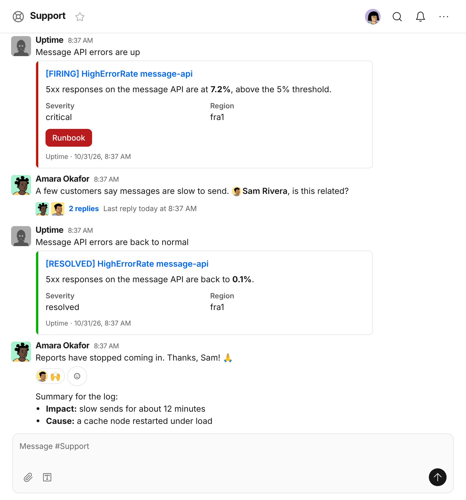

# Slack-compatible webhooks

Tools that post to Slack, such as Prometheus Alertmanager, Grafana or a CI pipeline, can post to a
room instead. The Chat bots page gives each of a bot's rooms a Slack-compatible webhook URL,
`https://<your Worker>/rooms/<room id>/<bot key>/slack`, which takes what a Slack incoming webhook
takes, as JSON or as a form's `payload` field:

```sh
curl -H 'Content-Type: application/json' -d '{"text": "Deploy *finished* :tada:"}' <url>
```

The bot posts the payload's `text`, read as Slack's mrkdwn, with its formatting, links, quotes, code
and emoji, and Ember answers as Slack does: `ok`, or what's wrong, such as `invalid_payload` or
`no_text`. Its legacy `attachments` show as cards under the text, each with a bar in its `color`,
and with its author, title, text, fields, image, link buttons and footer. Its Block Kit `blocks` show
as a card in place of the text, with headers, sections and their fields, context rows, rules, images,
rich text, Markdown, tables, small cards and carousels, and link buttons. A bot with a Webhook URL
keeps its [buttons that act](#buttons-that-act) too; menus, and whatever else only a Slack app could
answer, are left out. Mentions of Slack's people and channels show as text and notify nobody, and a
payload can't change the bot's name, avatar or room.



@ember and the [AI agents](self-hosting.md#ai-agents) post these cards too, as what Ember tells them
teaches them to. An answer that writes a payload as JSON in a code block starting
with ```` ```slack ```` shows the payload's cards under it, as the bot's message would, though only with
the pictures a person in the conversation linked to, as [Ember AI](self-hosting.md#ember-ai) says, and
without buttons that act.

## Buttons that act

A Block Kit button with an `action_id` and no `url` acts: a click on it goes to the bot that posted
the card, which can put a new card in its place. It works for a bot with a Webhook URL on the Chat
bots page, where the clicks are sent, in an actions block, as a section's accessory, or on a small
card:

```json
{
  "blocks": [
    { "type": "section", "text": { "type": "mrkdwn", "text": "Deploy *v42* to production?" } },
    {
      "type": "actions",
      "block_id": "deploy-42",
      "elements": [
        { "type": "button", "text": { "type": "plain_text", "text": "Approve" }, "action_id": "approve", "value": "42", "style": "primary" },
        { "type": "button", "text": { "type": "plain_text", "text": "Reject" }, "action_id": "reject", "value": "42", "style": "danger" }
      ]
    }
  ]
}
```

When someone clicks, Ember POSTs to the bot's Webhook URL what it sends for a message, about the
person who clicked and the bot's message, with the button as Slack's `block_actions` names it:

```json
{
  "type": "block_actions",
  "user": { "id": "00mwf…", "name": "Kai" },
  "room": { "id": "00mwe…", "name": "Deploys", "path": "/rooms/00mwe…/<key>/messages" },
  "message": { "id": "00mwg…", "body": { "html": null, "plain": "Deploy v42 to production?\nApprove · Reject" }, "path": "/rooms/00mwe…/@00mwg…" },
  "actions": [
    { "type": "button", "action_id": "approve", "block_id": "deploy-42", "value": "42", "text": { "type": "plain_text", "text": "Approve" }, "action_ts": "1794000000.000000" }
  ],
  "response_path": "/rooms/00mwe…/<key>/messages/00mwg…/slack"
}
```

A delivery for a message has no `type`, so that tells the two apart. The bot has 30 seconds to
answer, and the button waits until it does:

- **A payload as `application/json`** takes the message's place, its text and its cards, as Slack has
  an interactive message's answer do. With `"replace_original": false` it's posted as a new message
  instead, and `"delete_original": true` deletes the message.
- **`text/plain` or `text/html`** is posted as the bot's reply, as its answer to a message is.
- **An empty answer**, or `{}`, only takes the click.
- **Anything but a 2xx**, or no answer in time, tells the person who clicked that the bot couldn't take
  it, and changes nothing.

For work that takes longer, answer at once and POST a payload to `response_path` on your Ember's
address when it's done, as often as you like: it takes the message's place the same way, and
`"delete_original": true` deletes it. The address works for any message the bot posted, with the key
the delivery gives or the bot's own:

```sh
curl -H 'Content-Type: application/json' -d '{"text": "v42 is live :rocket:"}' https://<your Worker>/rooms/<room id>/<bot key>/messages/<message id>/slack
```

Anyone in the room can click, and `user` says who did: a bot that should act only for some people
checks that itself. Ember sends the button's `value` as the bot posted it, never as a browser says
it. Each person can have three clicks waiting on a room's bots at a time. Ember has no messages only
one person sees, so what a bot would send in Slack as an ephemeral message shows to the room; and
Slack's menus, date pickers, inputs, `confirm` dialogs and legacy attachment actions aren't here yet.

Slack is a trademark of Slack Technologies, LLC. Ember is not created by, affiliated with, or
supported by Slack Technologies, LLC.
